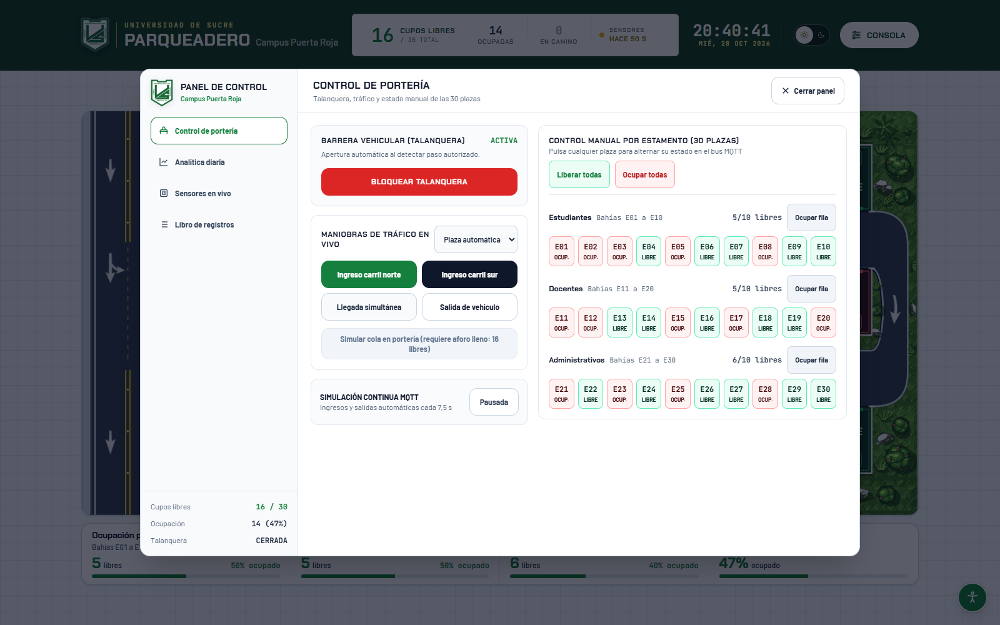

<h1 align="center">Parqueadero Unisucre</h1>

<p align="center">
  <b>HMI de parqueadero en tiempo real</b> · 30 plazas · MQTT + WebSocket<br>
  <i>Nodo sensor → Mosquitto → Fastify → Vue 3</i>
</p>

<p align="center">
  
  
  
  
  
  
  
  
  
  
</p>

## Qué contiene este repositorio

La aplicación completa y nada más: el backend, la interfaz, el broker y los scripts de operación. Con esto se replica el sistema en cualquier equipo.

El **nodo sensor no está incluido**. La aplicación no necesita el firmware para funcionar: habla con cualquier dispositivo que publique el contrato MQTT que se describe más abajo. Si no hay nodo conectado, las plazas se quedan en `SIN_DATO` hasta que alguien publique un estado.

## Qué resuelve

- **Estado real, no inventado.** La HMI solo pinta lo que llega del broker. Si el evento viene de un nodo, de `mosquitto_pub` o de otra pestaña, se anima igual.
- **30 plazas en tres zonas.** Estudiantes (E01–E10), docentes (E11–E20) y administrativos (E21–E30), con cupos por zona y ocupación general.
- **Consola de portería.** Bloqueo de la talanquera, cambio manual de plazas, maniobras de tráfico, analítica del día y libro de registros.
- **Accesibilidad de verdad.** Escala hasta 200 %, tipografías legibles, alto contraste, navegación por teclado y objetivos táctiles de 44 px.
- **Operación local.** Sin servicios en la nube: el broker, la base de datos y la UI corren en el equipo del kiosco.
- **Un comando y listo.** `docker compose up --build` deja broker, backend y HMI funcionando, con la PKI, la ACL y las claves generadas.

## Capturas

| Consola del operador | Modo oscuro |
|---|---|
|  |  |

> Capturas tomadas con datos de demostración y tráfico simulado. En operación normal las plazas arrancan en `SIN_DATO` hasta que el sensor reporta.

## Stack

| Capa | Tecnología | Para qué |
|---|---|---|
| Interfaz | [Vue 3](https://vuejs.org/) + [TypeScript](https://www.typescriptlang.org/) | Componentes reactivos y tipado del contrato |
| Build | [Vite](https://vite.dev/) | Servidor de desarrollo y build de producción |
| Estilos | [Tailwind CSS 4](https://tailwindcss.com/) | Tokens del campus, modo claro/oscuro y responsive |
| Servidor | [Fastify 5](https://fastify.dev/) | API HTTP, WebSocket y archivos estáticos |
| Datos | [SQLite](https://sqlite.org/) + [better-sqlite3](https://github.com/WiseLibs/better-sqlite3) | Estado por plaza e historial de ocupación |
| Mensajería | [MQTT](https://mqtt.org/) + [Eclipse Mosquitto](https://mosquitto.org/) | Transporte entre nodos y backend |
| Contrato | [Zod](https://zod.dev/) | Validación de payloads y topics compartidos |
| Herramientas | [Node.js 24](https://nodejs.org/) + [pnpm 11](https://pnpm.io/) | Runtime y monorepo |
| Despliegue | [Docker](https://docs.docker.com/) | Un comando levanta broker + backend + HMI |

## Cómo funciona

```
Nodo sensor --MQTT/TLS--> Mosquitto --MQTT--> Fastify (SQLite) --WS--> Vue 3
```

1. El nodo detecta el cambio y publica `parq/lote1/nodo-e01/espacios/E01/estado` con su certificado.
2. Mosquitto comprueba el certificado del nodo y su ACL: solo puede escribir sus propias plazas.
3. El backend suscribe `parq/+/+/espacios/+/estado`, valida lote, nodo y espacio, y persiste el cambio.
4. El backend publica los cupos en `parq/<lote>/disponibles` (retenido) y difunde el nuevo estado por `/ws`.
5. La HMI actualiza el plano, los contadores y la animación de la talanquera.

La simulación de tráfico del panel es un interruptor manual del operador: no arranca sola y publica por el mismo camino REST → MQTT → WebSocket que un sensor real.

## Detección de ocupación: dónde vive la histéresis

La decisión de si una plaza está ocupada la toma **el nodo**, no la aplicación. El backend recibe un `LIBRE` o un `OCUPADO` ya decidido y lo único que hace es validarlo contra la lista de plazas, guardarlo y difundirlo. Por eso la interfaz no puede inventar un estado aunque quiera.

El nodo no compara una distancia contra un solo umbral. Un vehículo detenido justo en el borde produce ecos que oscilan unos centímetros y, con un umbral único, la plaza parpadearía. Para evitarlo hay tres filtros en cascada.

### 1. Banda muerta por sensor (Schmitt)

Cada uno de los tres ultrasónicos tiene dos umbrales. Se activa cuando la distancia **es igual o menor** que el umbral de cerca y solo se libera cuando **supera** el de lejos. Entre ambos valores conserva lo que tenía.

| Sensor | Se activa con | Se libera con | Banda muerta |
|---|---|---|---|
| S1 | 120 cm o menos | más de 130 cm | 10 cm |
| S2 | 25 cm o menos | más de 30 cm | 5 cm |
| S3 | 30 cm o menos | más de 36 cm | 6 cm |

Cada sensor mide cinco veces por ciclo, espaciadas 60 ms, y se queda con la mediana de las cinco. Un pulso de eco menor a 120 µs se descarta como ruido del sensor y una lectura sin eco se reporta como 400 cm.

### 2. Voto por mayoría

La plaza se considera cerca cuando **al menos dos de los tres** sensores están en estado «cerca». Para liberarla hace falta lo simétrico: que al menos dos estén en «lejos». Un sensor que deja de responder durante tres ciclos seguidos se marca como fallo y queda fuera del conteo. Si quedan menos de dos sensores sanos, la distancia que se reporta se trata como «sin eco» y la ocupación no se puede confirmar.

### 3. Confirmación temporal

Un voto no cambia el estado por sí solo. Hacen falta **tres ciclos consecutivos** con el mismo resultado, hacia ocupado o hacia libre. Un ciclo dura lo que tardan los tres sensores en completar sus cinco pings: 3 × 5 × 60 ms = **900 ms**.

| Concepto | Valor |
|---|---|
| Pings por sensor y ciclo | 5 |
| Separación entre pings | 60 ms |
| Duración de un ciclo | 900 ms |
| Ciclos para confirmar un cambio | 3 |
| Latencia máxima de decisión | 2,7 s |
| Sensores que confirman | 2 de 3 |

La histéresis explica también por qué el sistema tolera una compensación térmica gruesa: la variación de la velocidad del sonido en el rango de temperaturas del campus es pequeña frente a la banda muerta de 5 a 10 cm.

## Transporte y costo

Cada camino usa el transporte que le corresponde. No hay solapamiento:

| Camino | Transporte | Frecuencia | Costo |
|---|---|---|---|
| Sensor → backend | MQTT (1883 backend, 8883 mTLS para nodos) | Por cambio de plaza | ~30 B extra por publicación (TLS) |
| Backend → navegador | WebSocket `/ws` | Push: snapshot al conectar + delta por cambio | 0 B si no hay cambios |
| Navegador → backend | HTTP REST | Solo por acción del operador | 1 petición por acción |
| Analítica e historial | HTTP REST | Al abrir la sección | 1 petición por consulta |

Por qué el estado **no** se consulta por HTTP en bucle:

- Un `GET /api/estado` devuelve **1694 B**. Con las cabeceras de petición y respuesta, un polling a 1 Hz serían unas 2,2 KB por segundo: 86 400 peticiones y **~190 MB al día por navegador**.
- Por WebSocket el costo es un handshake único y después **103 B por cada cambio real**. En un turno normal el tráfico del navegador es de kilobytes, no de megabytes.
- En el código **no hay polling**: el único temporizador de red de la web es el reconector del WebSocket, y la analítica se carga una vez al abrir la pestaña y se mantiene viva por WS.

HTTP se conserva para comandos y consultas porque el código de estado, las cabeceras (`x-admin-token`) y el registro de auditoría son gratis ahí, mientras que meterlos en WebSocket obligaría a inventar un sobre de mensajes para simular un 401. Las peticiones HTTP usan `keep-alive`, así que tampoco hay un TCP nuevo por llamada.

## Estructura del proyecto

```text
parqueadero/
├─ apps/
│  ├─ server/                      API, persistencia y puente MQTT
│  │  ├─ src/config.ts             Variables de entorno y validación fail-closed
│  │  ├─ src/db.ts                 Esquema SQLite, upsert y consultas
│  │  ├─ src/mqtt.ts               Cliente MQTT y validación de topics
│  │  ├─ src/http.ts               Rutas HTTP, token de operador y WebSocket
│  │  ├─ src/realtime.ts           Difusión del snapshot a las pestañas
│  │  └─ src/index.ts              Arranque y orden de inicialización
│  └─ web/                         HMI del kiosco
│     ├─ public/                   robots.txt, favicon y logo institucional
│     ├─ src/features/display/     Pantalla pública, cinta de telemetría y resumen
│     ├─ src/features/operador/    Consola, analítica, matriz y libro de registros
│     ├─ src/features/parqueadero/ Plano SVG, figuras, lógica de maniobras y WS
│     ├─ src/services/             Cliente HTTP, token y reconector del WebSocket
│     ├─ src/shared/               Tema, accesibilidad, pie institucional
│     └─ src/config/bahias.ts      Geometría del plano: coordenadas de las 30 plazas
├─ packages/shared/                Contrato MQTT, topics y tipos (Zod)
├─ broker/
│  ├─ mosquitto.conf               Puertos, TLS y límites del broker
│  ├─ nodos.json                   Nodos, plazas e identidades autorizadas
│  ├─ docker-entrypoint.sh         Prepara carpetas y permisos al arrancar
│  └─ Dockerfile                   Mosquitto + openssl, jq y clientes MQTT
├─ docker/app-entrypoint.sh        Arranque del contenedor de la aplicación
├─ docs/
│  ├─ docker.md                    Guía completa de contenedores
│  └─ capturas/                    Imágenes de este README
├─ scripts/                        Operación del broker y aprovisionamiento
│  ├─ provision-mqtt.sh            PKI, usuarios y ACL dentro de Docker
│  ├─ provision-mqtt.ps1           Lo mismo, para la instalación nativa en Windows
│  ├─ broker.ps1                   Arranca Mosquitto con la conf del proyecto
│  ├─ mqtt-log.ps1                 Sigue los mensajes del broker
│  └─ mqtt-nodo.ps1                Publica como nodo con certificado (banco de pruebas)
├─ Dockerfile                      Imagen de la aplicación (API + HMI)
├─ compose.yaml                    Stack completo: broker + app
├─ .env.example                    Plantilla de las variables del compose
├─ .editorconfig                   Estilo de código para el editor
├─ .gitattributes                  Finales de línea LF salvo binarios
├─ .nvmrc                          Versión de Node del proyecto (24)
├─ SECURITY.md                     Cómo reportar una vulnerabilidad
├─ LICENSE                         MIT
└─ package.json                    Comandos raíz del monorepo
```

El tablero no se indexa: `apps/web/public/robots.txt` bloquea a los rastreadores y la portada lleva `noindex, nofollow`. Vite copia esos archivos a `dist/`, y el backend los sirve desde la raíz.

Los dos aprovisionadores (`provision-mqtt.sh` y `provision-mqtt.ps1`) hacen exactamente lo mismo y escriben en los mismos archivos, así que se puede alternar entre Docker y la instalación nativa sin volver a configurar nada. El `.sh` es el que usa el contenedor `mqtt-init`, el `.ps1` es el que se invoca con `pnpm mqtt:provision` en Windows.

## Puesta en marcha

### Opción A · Docker (la más simple)

Con [Docker Desktop](https://docs.docker.com/desktop/) o Docker Engine, un solo comando levanta el broker, el backend y la HMI:

```bash
docker compose up --build
```

La primera vez el servicio `mqtt-init` genera la PKI, el usuario del broker, la ACL y las claves; después todo arranca solo. La aplicación queda en **http://localhost:8000**.

```bash
docker compose down      # detener (los datos y certificados se conservan)
docker compose logs -f app
```

Guía completa, certificados para un nodo y resolución de problemas: [`docs/docker.md`](docs/docker.md).

### Opción B · Nativo

#### Requisitos

- [Node.js 24](https://nodejs.org/) y [pnpm 11](https://pnpm.io/)
- [Mosquitto 2.1](https://mosquitto.org/download/) o superior
- [PowerShell 7](https://github.com/PowerShell/PowerShell) (`pwsh`)

#### Instalación

```powershell
pnpm install

# 1. Variables de entorno
Copy-Item apps/server/.env.example apps/server/.env
# Edita ADMIN_TOKEN (mínimo 12 caracteres) y MQTT_PASS

# 2. Certificados, usuarios y ACL del broker (una vez por equipo)
pnpm mqtt:provision

# 3. Broker en una terminal y la aplicación en otra
pnpm broker
pnpm dev
```

| Servicio | Dirección |
|---|---|
| HMI del kiosco | http://localhost:3000 |
| API | http://127.0.0.1:8000 |
| MQTT del backend | `127.0.0.1:1883` (loopback, usuario/clave + ACL) |
| MQTT de los nodos | `8883` (mTLS, abierto en la red local) |

En desarrollo, Vite sirve la UI y reenvía `/api` y `/ws` al backend del puerto 8000.

### Variables de entorno

Se leen de `apps/server/.env` (ver `apps/server/.env.example`).

| Variable | Por defecto | Nota |
|---|---|---|
| `ADMIN_TOKEN` | — | Obligatoria, mínimo 12 caracteres. Sin ella el servidor no arranca |
| `MQTT_URL` | `mqtt://127.0.0.1:1883` | Broker del backend |
| `MQTT_USER` | `backend` | Usuario definido en `broker/nodos.json` |
| `MQTT_PASS` | — | Clave del usuario `backend` |
| `LOTE` | `lote1` | Prefijo de los topics |
| `ESPACIOS` | `E01…E30` | Lista separada por comas |
| `PORT` | `8000` | Puerto de la API |
| `HOST` | `127.0.0.1` | Usa `0.0.0.0` si el kiosco se sirve desde otro equipo |

## MQTT

| Topic | Quién escribe | Contenido |
|---|---|---|
| `parq/<lote>/<nodo>/espacios/<id>/estado` | Nodo sensor | `{"v":1,"estado":"LIBRE"\|"OCUPADO"}` |
| `parq/<lote>/disponibles` | Backend | `{"v":1,"n":<cupos libres>}` retenido |
| `parq/<lote>/<nodo>/comandos/<dispositivo>` | Backend | Reservado para la talanquera; el payload aún no está definido |

El broker escucha en dos puertos:

- **1883**, solo en loopback, para el backend. Usuario y clave más ACL por identidad: puede publicar `disponibles` y comandos, nunca estados de plazas ajenas.
- **8883**, para los nodos, con TLS mutuo. El certificado identifica al nodo (`CN = nodo-e01`) y el ACL lo limita a sus plazas. Escucha en `0.0.0.0`, así que conviene acotarlo en el firewall a la subred del nodo.

Así, una clave robada no basta para hacerse pasar por un sensor: hace falta su certificado y su clave privada.

Para agregar un nodo:

1. Añade la entrada en `broker/nodos.json` con su nombre y sus plazas.
2. Ejecuta `pnpm mqtt:provision`.
3. Reinicia el broker.
4. Copia el certificado y la clave generados en `broker/certs/nodos/` al dispositivo.

## Seguridad

| Capa | Control |
|---|---|
| SQL | Todas las consultas van con parámetros (`prepare` + `?` / `@nombre`). El id de plaza se valida contra la lista configurada **antes** de tocar la base |
| Salida | Vue interpola: no hay `v-html` ni `innerHTML`. CSP `default-src 'self'` con `frame-ancestors 'none'` |
| Cabeceras | `nosniff`, `X-Frame-Options: DENY`, `Referrer-Policy`, `Cross-Origin-Opener-Policy: same-origin`, `Cross-Origin-Embedder-Policy: require-corp`, `Cross-Origin-Resource-Policy: same-origin`, `Permissions-Policy` y HSTS cuando el tráfico ya es HTTPS |
| Token | `ADMIN_TOKEN` obligatorio (mínimo 12 caracteres), comparación en tiempo constante (`timingSafeEqual`) y *fail-closed*: sin token el servidor no arranca |
| Autorización | El token protege el panel, el cambio de plazas, el historial y la analítica. `/api/estado` es público a propósito: es el tablero del kiosco |
| WebSocket | `/ws` rechaza con 403 los orígenes cruzados, antes incluso del *upgrade* |
| MQTT | Usuario/clave + ACL por identidad en 1883; mTLS con ACL por nodo en 8883. El certificado **es** la identidad del sensor: una clave robada no basta |
| DoS | 120 peticiones/min en el endpoint de operador y 10/min en la verificación de token; `max_packet_size 1024` y `max_connections 64` en el broker |
| Dependencias | `pnpm audit` sin hallazgos; los parches de las transitivas se fijan con `overrides` en `pnpm-workspace.yaml` |
| Contenedores | Usuario sin privilegios, sistema de archivos de solo lectura, `cap_drop: ALL`, `no-new-privileges`, límites de memoria y de PIDs, imágenes con versión fijada |

Los secretos quedan fuera del control de versiones: `.env`, `apps/server/.env`, `broker/passwd`, `broker/certs/` y las credenciales de cada nodo están en `.gitignore`.

Para reportar un hallazgo, usa el reporte privado de GitHub que se describe en [`SECURITY.md`](SECURITY.md).

## API HTTP

| Método | Ruta | Auth | Uso |
|---|---|---|---|
| `GET` | `/api/estado` | — | Snapshot de las 30 plazas y cupos libres |
| `GET` | `/api/sesion` | `x-admin-token` | Valida la clave del operador |
| `GET` | `/api/historial/:id` | — | Últimos 50 cambios de una plaza |
| `GET` | `/api/analitica/hoy` | — | Eventos del día en curso |
| `POST` | `/api/espacios/:id` | `x-admin-token` | Cambia una plaza (`LIBRE`/`OCUPADO`) |
| `GET` | `/ws` | — | Snapshot inicial y cambios en vivo |

## Scripts

Todos los comandos se ejecutan desde la raíz del repositorio.

| Comando | Archivo | Qué hace |
|---|---|---|
| `pnpm dev` | — | Web y servidor en paralelo con recarga |
| `pnpm broker` | `scripts/broker.ps1` | Arranca Mosquitto con `broker/mosquitto.conf` |
| `pnpm mqtt:provision` | `scripts/provision-mqtt.ps1` | Genera CA, certificados, usuarios y ACL |
| `pnpm mqtt:nodo` | `scripts/mqtt-nodo.ps1` | Publica como nodo con certificado (banco de pruebas, 8883) |
| `pnpm mqtt:log` | `scripts/mqtt-log.ps1` | Sigue los mensajes del broker |
| `pnpm check` | — | Typecheck de todos los paquetes |

Los `.ps1` requieren PowerShell 7 y se usan en la instalación nativa de Windows. En Docker el aprovisionamiento lo hace `scripts/provision-mqtt.sh` desde el contenedor `mqtt-init`, sin intervención manual.

## Accesibilidad

- Escala de interfaz al 150 % y 200 % con persistencia.
- Tipografías autoalojadas: Atkinson Hyperlegible, OpenDyslexic y Barlow; sin CDN.
- Modo oscuro desde el interruptor sol/luna del header, con contraste revisado.
- Navegación por teclado en el plano, enlace de salto y `aria-live` para los cupos.
- Objetivos táctiles de 44 px y barra de controles que no se solapa al hacer zoom.

## Estado y pendientes

- La HMI, la consola y la talanquera funcionan contra el broker real.
- El listener `8883` está abierto con mTLS y ACL por nodo. En Windows, acótalo en el firewall a la subred del nodo.
- Falta elegir el sensor de plaza definitivo; el FC-51 se descartó por luz solar.
- El nodo sensor es externo a este repositorio. Cualquier dispositivo que cumpla el contrato MQTT de arriba puede ocupar su lugar, incluido `mosquitto_pub` para pruebas.

## Documentación

La guía de contenedores, con el detalle de cada servicio, certificados, endurecimiento y resolución de problemas, está en [`docs/docker.md`](docs/docker.md).

## Licencia

[MIT](LICENSE) — ver el archivo `LICENSE` en la raíz del repositorio.
