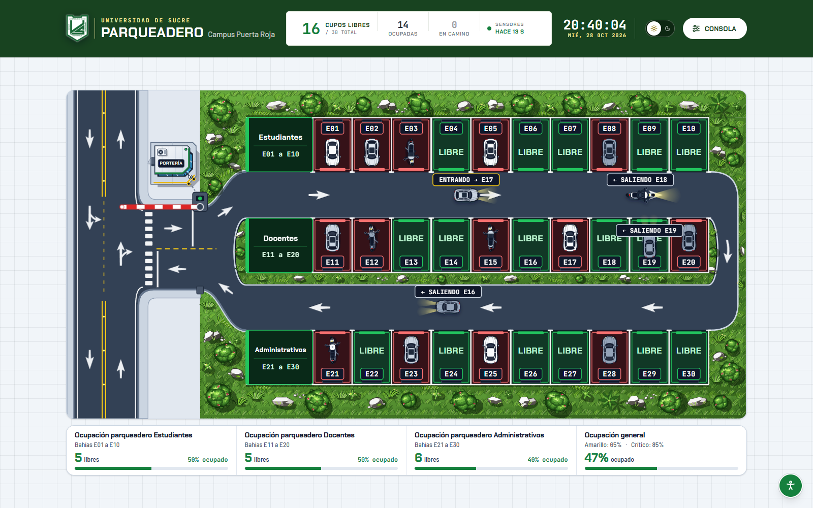
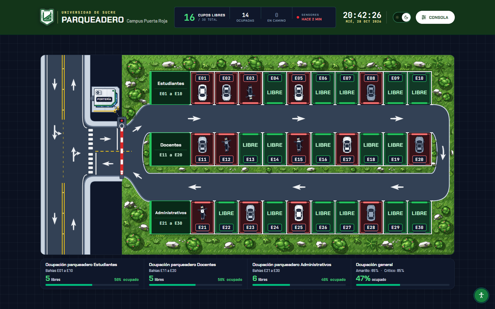

<h1 align="center">Parqueadero Unisucre</h1>

<p align="center">
  <b>HMI de parqueadero en tiempo real</b> · 30 plazas · MQTT + WebSocket<br>
  <i>ESP32 → Mosquitto → Fastify → Vue 3</i>
</p>

<p align="center">
  
  
  
  
  
  
  
  
  
  
</p>

*Estás viendo la rama `main`: la versión estable, única rama del proyecto y la que corre en el kiosco.*

| Rama | Propósito |
|---|---|
| [`main`](https://github.com/Praskc/parqueadero/tree/main) | Estable. Los cambios se integran aquí y se prueban contra el broker real |



## Qué resuelve

- **Estado real, no inventado.** La HMI solo pinta lo que llega del broker. Si el evento viene del ESP32, de `mosquitto_pub` o de otra pestaña, se anima igual.
- **30 plazas en tres zonas.** Estudiantes (E01–E10), docentes (E11–E20) y administrativos (E21–E30), con cupos por zona y ocupación general.
- **Consola de portería.** Bloqueo de la talanquera, cambio manual de plazas, maniobras de tráfico, analítica del día y libro de registros.
- **Accesibilidad de verdad.** Escala hasta 200 %, tipografías legibles, alto contraste, navegación por teclado y objetivos táctiles de 44 px.
- **Operación local.** Sin servicios en la nube: el broker, la base de datos y la UI corren en el equipo del kiosco.

## Capturas

| Consola del operador | Modo oscuro |
|---|---|
|  |  |

> Capturas tomadas con datos de demostración y tráfico simulado. En operación normal las plazas arrancan en `SIN_DATO` hasta que el sensor reporta.

## Stack

| Capa | Tecnología | Para qué |
|---|---|---|
| Interfaz | [Vue 3](https://vuejs.org/) + [TypeScript](https://www.typescriptlang.org/) | Componentes reactivos y tipado del contrato |
| Build | [Vite](https://vite.dev/) | Servidor de desarrollo y build de producción |
| Estilos | [Tailwind CSS 4](https://tailwindcss.com/) | Tokens del campus, modo claro/oscuro y responsive |
| Servidor | [Fastify 5](https://fastify.dev/) | API HTTP, WebSocket y archivos estáticos |
| Datos | [SQLite](https://sqlite.org/) + [better-sqlite3](https://github.com/WiseLibs/better-sqlite3) | Estado por plaza e historial de ocupación |
| Mensajería | [MQTT](https://mqtt.org/) + [Eclipse Mosquitto](https://mosquitto.org/) | Transporte entre nodos y backend |
| Contrato | [Zod](https://zod.dev/) | Validación de payloads y topics compartidos |
| Hardware | [ESP32](https://www.espressif.com/en/products/socs/esp32) + [Arduino](https://www.arduino.cc/) | Nodo de plaza y talanquera |
| Herramientas | [Node.js 24](https://nodejs.org/) + [pnpm 11](https://pnpm.io/) | Runtime y monorepo |

## Cómo funciona

```
ESP32 (nodo) --MQTT/TLS--> Mosquitto --MQTT--> Fastify (SQLite) --WS--> Vue 3
```

1. El nodo detecta el cambio y publica `parq/lote1/nodo-e01/espacios/E01/estado` con su certificado.
2. Mosquitto comprueba el certificado del nodo y su ACL: solo puede escribir sus propias plazas.
3. El backend suscribe `parq/+/+/espacios/+/estado`, valida lote, nodo y espacio, y persiste el cambio.
4. El backend publica los cupos en `parq/<lote>/disponibles` (retenido) y difunde el nuevo estado por `/ws`.
5. La HMI actualiza el plano, los contadores y la animación de la talanquera.

La simulación de tráfico del panel es un interruptor manual del operador: no arranca sola y publica por el mismo camino REST → MQTT → WebSocket que un sensor real.

## Transporte y costo

Cada camino usa el transporte que le corresponde. No hay solapamiento:

| Camino | Transporte | Frecuencia | Costo |
|---|---|---|---|
| Sensor → backend | MQTT (1883 backend, 8883 mTLS para nodos) | Por cambio de plaza | ~30 B extra por publicación (TLS) |
| Backend → navegador | WebSocket `/ws` | Push: snapshot al conectar + delta por cambio | 0 B si no hay cambios |
| Navegador → backend | HTTP REST | Solo por acción del operador | 1 petición por acción |
| Analítica e historial | HTTP REST | Al abrir la sección | 1 petición por consulta |

Por qué el estado **no** se consulta por HTTP en bucle:

- Un `GET /api/estado` devuelve **1694 B**. Con las cabeceras de petición y respuesta, un polling a 1 Hz serían unas 2,2 KB por segundo: 86 400 peticiones y **~190 MB al día por navegador**.
- Por WebSocket el costo es un handshake único y después **103 B por cada cambio real**. En un turno normal el tráfico del navegador es de kilobytes, no de megabytes.
- En el código **no hay polling**: el único temporizador de red de la web es el reconector del WebSocket, y la analítica se carga una vez al abrir la pestaña y se mantiene viva por WS.

HTTP se conserva para comandos y consultas porque el código de estado, las cabeceras (`x-admin-token`) y el registro de auditoría son gratis ahí, mientras que meterlos en WebSocket obligaría a inventar un sobre de mensajes para simular un 401. Las peticiones HTTP usan `keep-alive`, así que tampoco hay un TCP nuevo por llamada.

## Estructura del proyecto

```text
parqueadero/
├─ apps/
│  ├─ server/                     API y persistencia
│  │  ├─ src/config.ts            Variables de entorno y validación fail-closed
│  │  ├─ src/db.ts                Esquema SQLite, upsert y consultas
│  │  ├─ src/mqtt.ts              Cliente MQTT y validación de topics
│  │  ├─ src/http.ts              Rutas HTTP, token de operador y WebSocket
│  │  └─ src/realtime.ts          Difusión del snapshot a las pestañas
│  └─ web/                        HMI
│     ├─ src/features/display/    Pantalla del kiosco y cinta de telemetría
│     ├─ src/features/operador/   Consola, analítica y libro de registros
│     ├─ src/features/parqueadero/ Plano SVG, figuras y simulación vial
│     └─ src/shared/              Tema, accesibilidad, pie institucional
├─ packages/shared/               Contrato MQTT y tipos (Zod)
├─ broker/                        mosquitto.conf, nodos.json y ACL generada
├─ firmware/                      Nodo ESP32: E01 + talanquera
├─ docs/capturas/                 Imágenes de este README
└─ scripts/                       Arranque del broker y aprovisionamiento
```

## Puesta en marcha

### Requisitos

- [Node.js 24](https://nodejs.org/) y [pnpm 11](https://pnpm.io/)
- [Mosquitto 2.1](https://mosquitto.org/download/) o superior
- [PowerShell 7](https://github.com/PowerShell/PowerShell) (`pwsh`)

### Instalación

```powershell
pnpm install

# 1. Variables de entorno
Copy-Item apps/server/.env.example apps/server/.env
# Edita ADMIN_TOKEN (mínimo 12 caracteres) y MQTT_PASS

# 2. Certificados, usuarios y ACL del broker (una vez por equipo)
pnpm mqtt:provision

# 3. Broker en una terminal y la aplicación en otra
pnpm broker
pnpm dev
```

| Servicio | Dirección |
|---|---|
| HMI del kiosco | http://localhost:3000 |
| API | http://127.0.0.1:8000 |
| MQTT del backend | `127.0.0.1:1883` (loopback, usuario/clave + ACL) |
| MQTT de los nodos | `8883` (mTLS, desactivado hasta conectar la placa) |

En desarrollo, Vite sirve la UI y reenvía `/api` y `/ws` al backend del puerto 8000.

### Variables de entorno

Se leen de `apps/server/.env` (ver `apps/server/.env.example`).

| Variable | Por defecto | Nota |
|---|---|---|
| `ADMIN_TOKEN` | — | Obligatoria, mínimo 12 caracteres. Sin ella el servidor no arranca |
| `MQTT_URL` | `mqtt://127.0.0.1:1883` | Broker del backend |
| `MQTT_USER` | `backend` | Usuario definido en `broker/nodos.json` |
| `MQTT_PASS` | — | Clave del usuario `backend` |
| `LOTE` | `lote1` | Prefijo de los topics |
| `ESPACIOS` | `E01…E30` | Lista separada por comas |
| `PORT` | `8000` | Puerto de la API |
| `HOST` | `127.0.0.1` | Usa `0.0.0.0` si el kiosco se sirve desde otro equipo |

## MQTT

| Topic | Quién escribe | Contenido |
|---|---|---|
| `parq/<lote>/<nodo>/espacios/<id>/estado` | Nodo sensor | `{"v":1,"estado":"LIBRE"\|"OCUPADO"}` |
| `parq/<lote>/disponibles` | Backend | `{"v":1,"n":<cupos libres>}` retenido |
| `parq/<lote>/<nodo>/comandos/<dispositivo>` | Backend | Reservado para la talanquera; el payload aún no está definido |

El broker escucha en dos puertos:

- **1883**, solo en loopback, para el backend. Usuario y clave más ACL por identidad: puede publicar `disponibles` y comandos, nunca estados de plazas ajenas.
- **8883**, para los nodos, con TLS mutuo. El certificado identifica al nodo (`CN = nodo-e01`) y el ACL lo limita a sus plazas. Está comentado en `broker/mosquitto.conf` hasta que la placa esté conectada.

Así, una clave robada no basta para hacerse pasar por un sensor: hace falta su certificado y su clave privada. Para agregar un nodo: edita `broker/nodos.json`, ejecuta `pnpm mqtt:provision` y reinicia el broker.

## API HTTP

| Método | Ruta | Auth | Uso |
|---|---|---|---|
| `GET` | `/api/estado` | — | Snapshot de las 30 plazas y cupos libres |
| `GET` | `/api/sesion` | `x-admin-token` | Valida la clave del operador |
| `GET` | `/api/historial/:id` | — | Últimos 50 cambios de una plaza |
| `GET` | `/api/analitica/hoy` | — | Eventos del día en curso |
| `POST` | `/api/espacios/:id` | `x-admin-token` | Cambia una plaza (`LIBRE`/`OCUPADO`) |
| `GET` | `/ws` | — | Snapshot inicial y cambios en vivo |

## Scripts

| Comando | Qué hace |
|---|---|
| `pnpm dev` | Web y servidor en paralelo con recarga |
| `pnpm broker` | Arranca Mosquitto con `broker/mosquitto.conf` |
| `pnpm mqtt:provision` | Genera CA, certificados, usuarios y ACL |
| `pnpm mqtt:nodo` | Publica como nodo con certificado (banco de pruebas, 8883) |
| `pnpm mqtt:log` | Sigue los mensajes del broker |
| `pnpm check` | Typecheck de todos los paquetes |

## Accesibilidad

- Escala de interfaz al 150 % y 200 % con persistencia.
- Tipografías autoalojadas: Atkinson Hyperlegible, OpenDyslexic y Barlow; sin CDN.
- Modo oscuro desde el interruptor sol/luna del header, con contraste revisado.
- Navegación por teclado en el plano, enlace de salto y `aria-live` para los cupos.
- Objetivos táctiles de 44 px y barra de controles que no se solapa al hacer zoom.

## Firmware

`firmware/nodo-parqueadero` cubre la plaza E01 y la talanquera: HC-SR04, servo y LEDs, sin WiFi ni MQTT todavía. Los pines, la histéresis y la máquina de estados están documentados en [`firmware/README.md`](firmware/README.md).

> El ESP32 no tolera 5 V en sus GPIO. El ECHO del ultrasónico necesita divisor a 3.3 V.

## Estado y pendientes

- La HMI, la consola y la talanquera funcionan contra el broker real.
- El listener `8883` sigue desactivado: se habilita cuando llegue la placa y se pruebe en banco.
- Falta elegir el sensor de plaza definitivo (el FC-51 se descartó por luz solar).
- El firmware aún no publica por MQTT; primero se depura por serial.

## Documentación

[`contexto-mqtt-parqueadero.md`](contexto-mqtt-parqueadero.md) reúne el diseño completo: contrato MQTT, broker y PKI, API, HMI, firmware y el historial de decisiones del equipo.

## Licencia

[MIT](LICENSE) — ver el archivo `LICENSE` en la raíz del repositorio.
